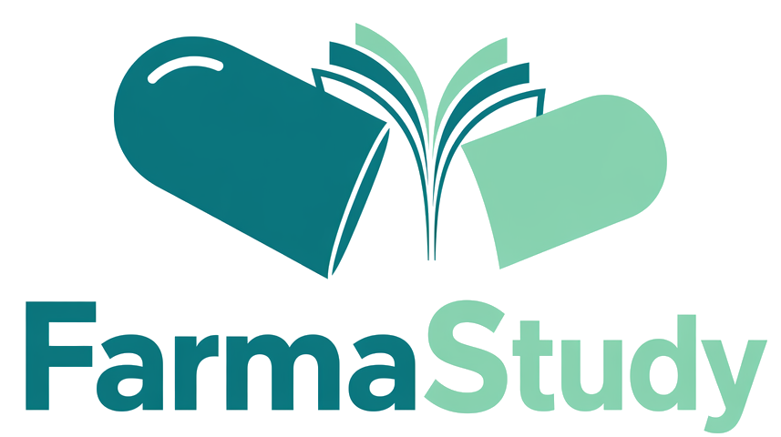
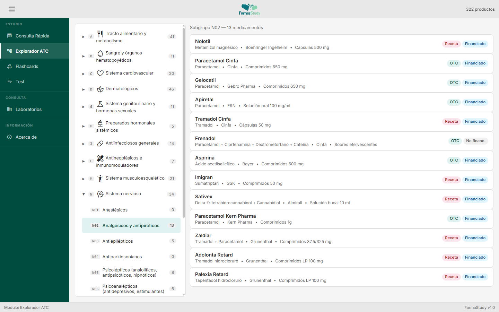
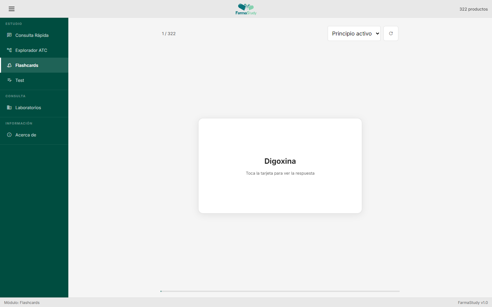
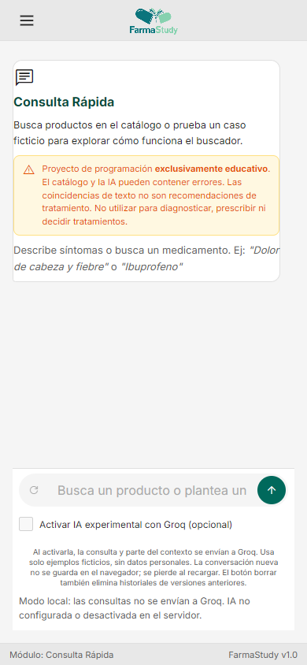

# FarmaStudy

**Proyecto personal de aprendizaje de programación con temática farmacológica.**



Desarrollé FarmaStudy para practicar cómo construir una aplicación web con funcionalidades conectadas: un catálogo, navegación entre vistas, búsquedas, tarjetas de repaso y cuestionarios. Es un proyecto complementario de mi portafolio, no mi aplicación principal ni un producto sanitario.

La versión actual utiliza **JavaScript sin frameworks, CSS y PHP**. Incluye una integración **opcional y experimental con Groq**, desactivada inicialmente en la interfaz. No hace falta configurar IA para probar el proyecto.

> **Solo para demostración y aprendizaje.** El catálogo y las respuestas de IA pueden contener errores. No están validados para uso clínico y no deben utilizarse para diagnosticar, prescribir ni decidir tratamientos. Utiliza ejemplos ficticios y nunca datos personales o sanitarios reales.

## Funcionalidades

- **Consulta rápida:** búsqueda local por texto, nombres y principios activos; IA opcional con activación voluntaria.
- **Explorador ATC:** grupos y subgrupos del catálogo, junto con categorías propias para parafarmacia.
- **Fichas:** datos educativos del producto, laboratorio, presentación y productos relacionados.
- **Flashcards:** repaso por principio activo/composición, laboratorio o indicación, con navegación táctil y por teclado.
- **Test:** hasta 10 preguntas sobre medicamentos, cuatro opciones diferentes y resultados al terminar.
- **Laboratorios:** directorio y productos asociados.

El conjunto de datos incluido contiene **202 medicamentos, 120 productos de parafarmacia y 55 fichas de laboratorios/marcas**. Son registros locales de demostración, no una consulta en tiempo real a CIMA. Los detalles y las limitaciones están en [Datos](docs/DATOS.md).

### Capturas

**Explorador del catálogo**



<details>
<summary>Ver flashcards y consulta en móvil</summary>





</details>

## Qué practiqué

- Manipulación del DOM y eventos sin un framework de interfaz.
- Organización modular del código y ciclo de vida de las vistas.
- Estado compartido mediante publicación/suscripción.
- Búsqueda de texto, normalización de acentos y tratamiento de datos.
- Diseño adaptable con CSS, tarjetas interactivas y cuestionarios aleatorios.
- Peticiones asíncronas, cancelación y alternativa local ante errores.
- Comunicación **navegador → proxy PHP → API externa**, manteniendo las credenciales fuera del frontend.

## Ejecutar en local

### Requisitos

- **PHP 8.1 o superior**; revisado con PHP 8.3.
- Navegador moderno.
- Extensión PHP **cURL** y conexión HTTPS saliente únicamente si quieres probar Groq.
- **Node.js 22 o superior solo para las pruebas automatizadas**, no para ejecutar la aplicación.

No requiere Node.js para arrancar, ni npm, Composer, base de datos o compilación.

### Arranque en Windows / PowerShell

Desde esta carpeta:

```powershell
cd "C:\Users\arobl\Desktop\01_Proyectos_Web\FarmatStudy"
php -S 127.0.0.1:8000 -t . router.php
```

Abre **http://127.0.0.1:8000**. Para detener el servidor, pulsa **Ctrl+C**.

En otra ubicación o sistema, entra en la raíz del proyecto y utiliza el mismo comando `php -S`. El router de desarrollo permite solo la entrada, el proxy y los recursos públicos; bloquea configuración, archivos ocultos y pruebas.

### Primera prueba, sin IA

1. Deja desmarcada la casilla de Groq en Consulta rápida.
2. Busca `ibuprofeno`: deben aparecer coincidencias locales, sin enviar la consulta a Groq.
3. Abre una ficha y vuelve al explorador.
4. Prueba Flashcards y completa un Test.

Las fuentes e iconos se cargan desde Google Fonts: no se garantiza funcionamiento visual completo sin conexión. No se ha implementado una PWA ni un modo offline completo.

### IA opcional

La clave se carga desde el entorno del servidor o un archivo privado **fuera de la raíz pública**. Consulta los pasos completos en [Seguridad y configuración de Groq](docs/SEGURIDAD.md).

El programa **no carga archivos `.env` automáticamente**. No pegues una clave en el JavaScript, `index.php`, el cargador `php/config.php` ni la documentación.

Aunque el servidor esté configurado, el navegador no envía consultas a Groq hasta marcar **Activar IA experimental**. Al hacerlo se envían el texto, parte del contexto de la conversación y, si procede, descripciones del catálogo para una segunda comparación. Esta comparación no es validación sanitaria.

## Privacidad

- Las conversaciones nuevas permanecen en memoria; se pierden al recargar o cerrar la página.
- No se escriben conversaciones nuevas en `localStorage`, cookies ni archivos del servidor.
- El botón **Borrar conversación** también elimina las claves de historial de versiones anteriores en ese navegador y origen. No se restauran esos historiales antiguos.
- Al activar Groq se aplican también las condiciones de tratamiento del proveedor. No se promete confidencialidad ni ausencia de retención externa.
- El servidor guarda contadores de uso con un hash de la dirección IP, sin contenido de consultas. El alojamiento puede mantener sus propios registros de acceso.

## Estructura

```text
FarmatStudy/
├── index.php                 # Entrada y configuración pública (solo disponibilidad de IA)
├── router.php                # Router del servidor local de PHP
├── php/
│   ├── config.php            # Cargador sin credenciales
│   ├── config.example.php    # Plantilla sin secretos para el archivo privado
│   ├── seguridad.php         # Validación de solicitudes y límites
│   ├── groq-transporte.php   # Certificados HTTPS y clasificación de errores
│   └── api-groq.php          # Proxy con modelo fijado en el servidor
├── js/
│   ├── principal.js          # Inicialización
│   ├── nucleo/               # Estado, navegación, datos, privacidad, IA y cuestionarios
│   └── modulos/              # Vistas y sus eventos
├── datos/                    # Catálogos JavaScript locales
├── estilo/                   # CSS por área y reglas adaptables
├── recursos/                 # Logo y otros recursos visuales
├── iconos/
├── docs/                     # Arquitectura, datos, seguridad y mejoras
└── tests/                    # Pruebas sin dependencias de terceros

FarmatStudy-private/           # Carpeta hermana: NO forma parte del proyecto público
├── config.php                # Opcional: clave privada
└── limites/                  # Contadores creados por el servidor
```

## Pruebas

Desde la raíz:

```powershell
node --test tests/*.test.cjs
php tests/seguridad.php
```

Las pruebas usan datos locales, respuestas simuladas y servidores de prueba con IA desactivada o con cuota agotada deliberadamente. **No utilizan tu clave ni llaman a Groq.** Comprueban integridad estructural del catálogo, búsquedas, opciones únicas, consentimiento inicial, fallo seguro de la comparación, validación y límites del proxy. No comprueban exactitud farmacológica.

En Windows también puedes ejecutar `pwsh -File tests/comprobar.ps1` para comprobar sintaxis y ejecutar ambas suites. PHP y Node deben estar en `PATH`.

Prueba opcional de interfaz con Chrome/Chromium instalado (sin dependencias npm):

```powershell
node tests/interfaz.cjs
```

Comprueba escritorio a 1440 × 900 y móvil a 390 × 844, abre un servidor de prueba con IA desactivada y usa un perfil temporal independiente de tu navegador. Si no detecta Chrome/Edge, define `CHROME_PATH` con la ruta del ejecutable. Añade `--capturas` para actualizar las tres imágenes de `docs/capturas/`.

La prueba de interfaz simula además un error de certificados y una respuesta posterior correcta: comprueba que el chat informa del problema y vuelve a mostrar respuestas sin usar una clave real. Si aparece un error HTTPS en tu instalación, consulta [la configuración de certificados](docs/SEGURIDAD.md#si-el-chat-devuelve-un-error-de-certificados-o-502).

## Despliegue y repositorio

La versión PHP necesita un alojamiento que ejecute PHP; **GitHub Pages no ejecuta este backend**. Publica únicamente la carpeta del proyecto, nunca su carpeta privada hermana. Configura HTTPS y permisos de escritura solo para el directorio privado de contadores. El servidor integrado de PHP es solo para desarrollo.

El proyecto comenzó con una versión anterior basada en **Vite e `index.html`**, conservada en el historial de [GitHub](https://github.com/andres-robles-dev/FarmatStudy-Medicamentos-). Este README documenta la versión actual con **PHP**. En ella no existen `package.json`, `npm run dev` ni `npm run build`.

## Documentación y próximos pasos

- [Arquitectura y mantenimiento](docs/ARQUITECTURA.md)
- [Configuración, seguridad y límites](docs/SEGURIDAD.md)
- [Origen y limitaciones de los datos](docs/DATOS.md)
- [Mejoras pendientes y presentación del portafolio](docs/MEJORAS.md)

**Autor:** Andrés Robles · [GitHub](https://github.com/andres-robles-dev)

No se ha añadido una licencia de distribución: su elección corresponde al autor. Las marcas, recursos y fuentes de datos pueden tener condiciones independientes.
